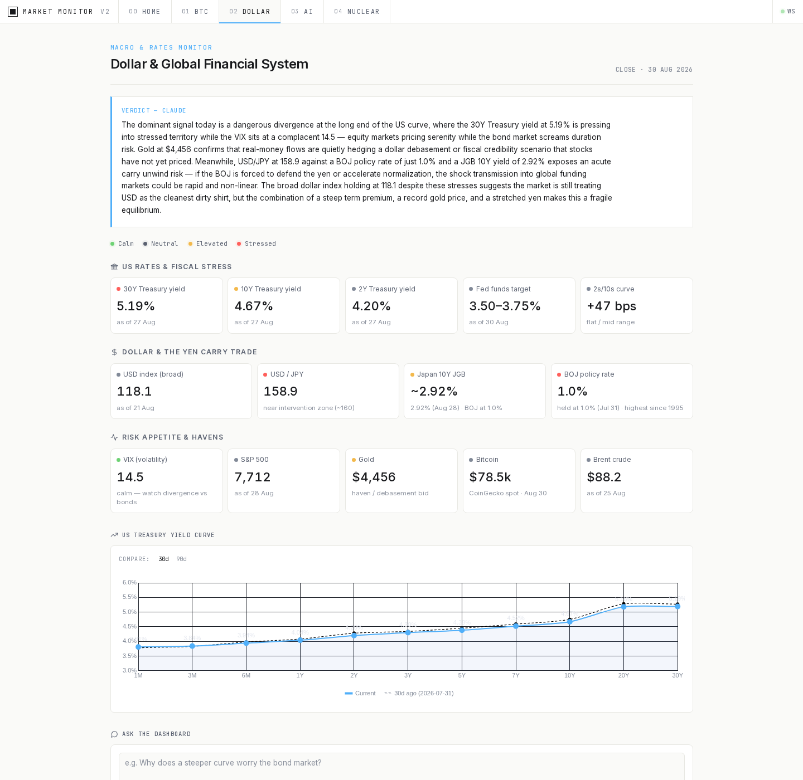
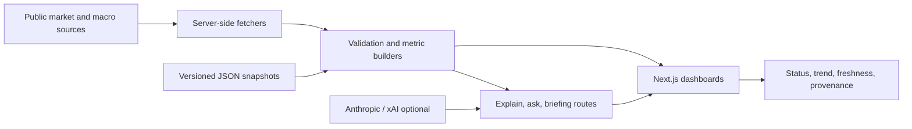
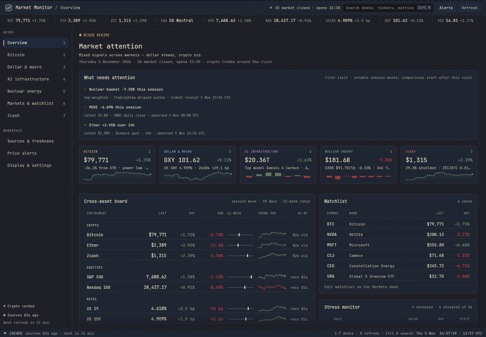

# Market Monitor

A source-aware decision dashboard that connects four technology-and-markets questions in one interface: **dollar liquidity, Bitcoin, AI infrastructure, and nuclear energy**.



> Screenshot uses public market data. AI interpretation is optional; the underlying dashboard remains usable without model credentials.

## Recruiter quick read

| Signal | Evidence in this repository |
|---|---|
| **Analytics / BI** | Multi-source metrics are normalized into status, trend, freshness, and provenance fields before presentation. |
| **Energy + technology** | Dedicated nuclear and AI-infrastructure views connect operating data, market structure, and source notes. |
| **Product engineering** | Responsive Next.js interface, server-side API routes, error states, Docker deployment, and scheduled snapshot refreshes. |
| **Decision discipline** | Static snapshots provide a reproducible baseline; live overlays and AI summaries are clearly separated from source data. |

## What the product does

- **Home** — one-screen regime summary across macro, BTC, AI, and nuclear signals.
- **Dollar & Macro** — a dated snapshot of dollar-system metrics with source notes and explainable status thresholds.
- **Bitcoin** — price, cycle, macro, and network context in a research-oriented terminal view.
- **AI Infrastructure** — company and model snapshots, public-market overlays, and source-level confidence metadata.
- **Nuclear Energy** — reactor, uranium, and public-company signals with dated evidence and a separate live-source layer.
- **Optional interpretation** — ask/explain routes and daily briefings run server-side; credentials never enter the client bundle.

## Architecture



The key design choice is the boundary between **facts** and **interpretation**. Metric values, dates, and sources are structured data; model output is an optional narrative layer.

## Local desktop app

The local client is a native Rust app in `desktop/`. It opens from a disk cache, then refreshes about thirty public feeds in the background. No Node server or API keys are required for public data.



- **Overview:** three ranked developments, including changes since the previous visit, large sector moves, rule crossings and source-quality changes. Each links to its evidence and shows the observation or receipt time. Compact desk summaries keep the watchlist and stress monitor accessible on a laptop; the full cross-asset board remains available.
- **Bitcoin:** key readings for valuation, cycle, sentiment and flows, followed by price history with range selectors, log scale and the descriptive power-law fit ±1σ. Extended log-log research is expandable. Net liquidity, perp funding by venue, Coinbase premium, spot ETF flows, Strategy issuance, correlations, macro regime score and market emotion remain below.
- **Dollar & macro:** stress rules with daily moves and the rule behind each status, the Treasury curve against one week, one month or three months ago, ICE DXY history and the macro backdrop.
- **AI:** intelligence vs. token cost from the Artificial Analysis leaderboard, the frontier model table, listed and private names, market structure and what to watch. A brief verdict expands into the full dated research note. When the leaderboard is unreadable, the last scored roster stays and OpenRouter prices fill in.
- **Nuclear:** listed names and uranium ETFs, U3O8 history, companies and projects, operating facts and what to watch, with expandable dated research. The web home card uses the sourced monthly FRED uranium series and shows its date; unavailable history stays empty.
- **Markets:** one sortable table of crypto, AI, nuclear and ETF quotes with favorites, filter and CSV export of the current view to `~/Downloads`.
- **Zcash:** price history, ZEC/BTC, shielded value pools from a public zcashd node, issuance and halving, Blockchair network activity, perp funding and open interest.
- **X Pulse:** Grok searches the preceding 48 hours of X conversations across Bitcoin, macro, AI, nuclear and Zcash. A summary on Overview opens the full desk, with topic filters, qualitative sentiment, confidence, bull/bear cases, observations to watch and dated post links. Missing sectors are shown explicitly. This is a searched sample, not measured X-wide sentiment.
- **What ranks as a development:** a move must exceed the instrument's own typical day (standard deviation of its cached daily changes), so a routine VIX or ZEC swing does not outrank a rare S&P move. For VIX, MOVE, DXY and USD/JPY a rise is the stress direction. Source notices rank below market developments.
- **Workspace:** a command palette (`Ctrl+K`) across desks, tickers, companies, metrics and sources; Sources & freshness lists every feed with its last successful response; price alerts for BTC, ETH and ZEC fire once on live ticks with a banner and a desktop notification, then wait to be rearmed.

```bash
cd desktop
cargo run --release
```

`1`–`8` switch desks, `Ctrl+K` searches, `R` refreshes public sources, and `Esc` closes dialogs and the detail panel. `cargo run --release -- --fetch` refreshes and prints one snapshot, then exits. Watchlist, alert, display, chart preferences, and the previous visit's comparison readings are saved locally. A visit follows attention: after four hours without window focus, the readings from the moment focus was lost become the comparison.

A dollar rule that changes status on a new dated reading sends a desktop notification, at most once per rule every six hours (Settings → Data turns it off). Each day's first refresh appends one row of readings, rule statuses and the regime score to `~/.local/share/dollar-dashboard/readings.jsonl` (or `$XDG_DATA_HOME`), so the rules can later be checked against outcomes.

To use your Grok subscription, open desk `8`, click **Copy Grok prompt**, paste it into Grok chat with X search enabled, then paste its complete JSON answer into **Import brief from Grok chat** and click **Import brief**. No API key is needed. The app checks post URLs and publication times encoded in their IDs, and labels the report as imported; these checks cannot independently verify the search or interpretation. The tested Grok Build CLI login did not expose X search, so it is not used as a live-data provider.

Automatic search is available separately through the [xAI X Search API](https://docs.x.ai/developers/tools/x-search), billed to API credits. Launch the app with `XAI_API_KEY` in its environment; the optional automatic-search section then enables **Refresh via xAI API** and hourly refresh while open (off by default). `XAI_PULSE_MODEL` overrides the default `grok-4.7`. Requests allow at most eight tool calls and 6,000 output tokens, with a three-minute timeout; fetched-post counts and token usage determine billing, so this is not a fixed dollar budget. No API call runs until a refresh is requested or hourly refresh is enabled. The headless `--x-pulse` option explicitly requests one API refresh.

API reports must include a completed response, a nonzero provider-reported X-post retrieval count, and provider citations matching every linked post. Reports from either route reject out-of-window posts and keep the last successful report on error. The X cache is separate from prices at `~/.cache/dollar-dashboard/x-pulse.json` (or `$XDG_CACHE_HOME/dollar-dashboard/`). A cached report becomes stale after one hour. Without a sourced report, the app displays an empty state rather than synthetic sentiment.

Crypto ticks arrive every two seconds from Binance, every ten while the window is unfocused, backing off on errors and honouring rate-limit waits. Equity, index, FX and futures quotes are delayed TradingView prints; their daily history comes from CNBC chart data and refreshes every two hours. Treasury yields on the Dollar desk are official daily closes, while the board shows the delayed session yield. AI and nuclear company evidence stays on the dated snapshot shipped with the repo. Rule readings are explicit thresholds, not a model call. Credential-dependent AI Q&A remains in the browser version; desktop X Pulse is a separate Grok interpretation layer.

Price timing follows each instrument: an older background response cannot replace a newer spot tick, cached values are labelled as cached, and a receipt timestamp is distinguished from an actual observation timestamp. Old caches remain readable, but legacy liquidity calculations are cleared until a complete corrected refresh succeeds. Liquidity uses WALCL and WTREGEN in millions of dollars and RRPONTSYD in billions; an unavailable component never becomes a zero balance. The regime score follows the same rule: no score or allocation unless all five inputs answered, and the last complete score is kept. Both clients verify the same examples in `testdata/net-liquidity.json`.

Desktop validation:

```bash
cd desktop
cargo test --offline
cargo build --release --offline
# Optional: call every live feed once and print which ones answered
cargo test --offline --lib live_refresh_reports_every_feed -- --ignored --nocapture
# Optional visual QA without a running or unlocked desktop:
cargo test export_ui_previews -- --ignored
uv run --no-project --with numpy --with pillow scripts/render-previews.py
```

The optional renderer uses NumPy and Pillow in an isolated `uv` environment and writes previews to `/tmp/market-monitor-qa`; neither package is an application dependency.

The Next.js app below is the browser version of the same monitor.

## Run locally

Requires Node.js 20.9 or newer.

```bash
npm install
npm run dev
```

Open <http://localhost:3000>. Public-data and snapshot views render without LLM credentials.

Optional server-side integrations:

| Variable | Purpose |
|---|---|
| `ANTHROPIC_API_KEY` | Explain, ask, interpretation, and snapshot-refresh routes |
| `FRED_API_KEY` | Live FRED overlays and yield-curve history |
| `XAI_API_KEY` | Optional recent-X summary on AI and nuclear views |
| `EXPLAIN_MODEL` / `ASK_MODEL` / `BRIEFING_MODEL` / `INTERPRETATION_MODEL` | Override Anthropic models |
| `LLM_PER_CLIENT_HOURLY_LIMIT` / `LLM_DAILY_LIMIT` | Spend limits for the ask/explain routes (defaults 20 and 200) |
| `SEC_CONTACT` | Contact string for the SEC EDGAR User-Agent |
| `XAI_SUMMARY_MODEL` | Override the xAI summary model |
| `ENABLE_WEB_SEARCH=true` | Explicit gate for the snapshot refresh script |

## Quality gates

```bash
npm test
npm run lint
npm run build
```

CI runs these web checks and the Rust desktop suite, including the shared data contract.

The weekly snapshot workflow opens a reviewable PR only when `ANTHROPIC_API_KEY` is configured. Without that secret it exits cleanly with an explicit skip instead of producing a red scheduled run.

## Snapshot refresh

Slow-moving AI-infrastructure data lives in `lib/aiSnapshot.json`. Each value carries an `asOf` date, source, and confidence. The refresh script re-verifies that snapshot and supports a dry run:

```bash
ENABLE_WEB_SEARCH=true npm run refresh:snapshots -- --dry-run
```

Writing a refreshed snapshot additionally requires the server-side Anthropic key. Generated changes are reviewed as a diff before they become the new baseline.

## VPS deployment

```bash
docker compose up -d --build
curl http://127.0.0.1:3001/api/health
```

The production image uses Next.js standalone output and exposes container port `3000`; the included Compose file maps it to host port `3001` by default.

## Limitations

- This is an analytical monitor, not investment advice or an execution system.
- Source calendars differ, so freshness is shown per metric rather than hidden behind a single “live” label.
- Provider failures degrade individual overlays; they should not invalidate dated snapshots.
- AI summaries can be wrong and are never treated as the source of record.

## Codex conversations in the desktop app

Click **Ask Codex** in the title bar to discuss the current desk, or choose
**Explain this view** in the chat. Each turn includes the current snapshot,
selected item, timestamps, and research notes for the desk. Follow-up questions
resume the same Codex conversation; the transcript survives an app restart.
**Stop** cancels an answer; **New chat** starts a separate conversation.

This uses the installed `codex` CLI and its existing login (`codex login`),
without an API key. `MARKET_MONITOR_CODEX` can override its executable path.
The conversation explains supplied app data; web lookup and command execution
are disabled, so it cannot independently establish the cause of a market move.
